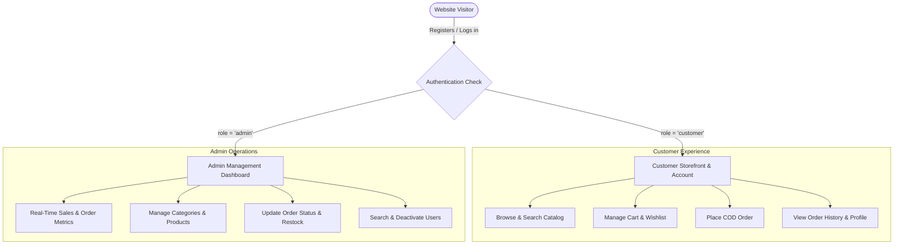
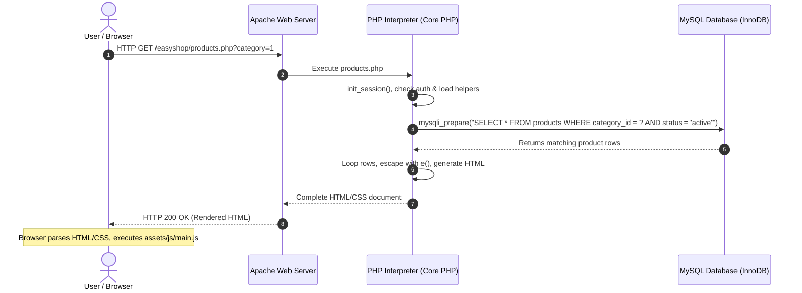
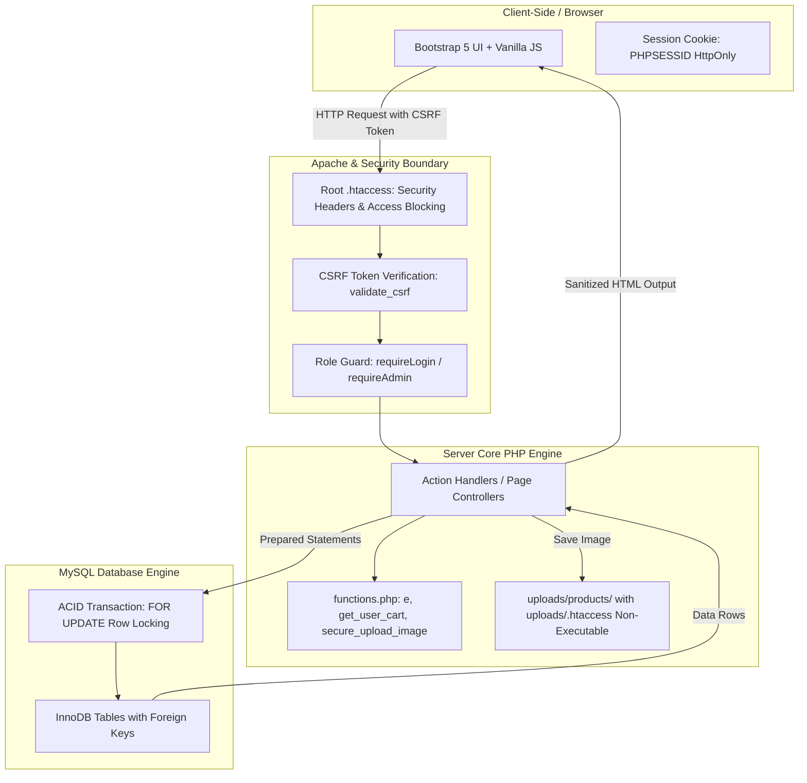

# EasyShop — Project Overview & System Architecture

Welcome to the comprehensive learning guide for **EasyShop**. This guide is specially designed for you as a BS Artificial Intelligence student with foundational knowledge of web development (HTML, CSS, Bootstrap, JavaScript, Core PHP, and MySQL).

In this document, you will learn what EasyShop is, the problem it solves, the reasoning behind each technology choice, and how all components interact in a professional client-server architecture.

---

## 1. What is EasyShop?

**EasyShop** is a production-ready, single-vendor e-commerce web platform engineered specifically for the Pakistani retail market. It allows customers across Pakistan to browse products, filter by categories, maintain a persistent shopping cart and wishlist, and place orders using **Cash on Delivery (COD)** with a standardized flat shipping fee of **Rs. 200**.

At the same time, it provides store administrators with a comprehensive, role-protected management portal to handle product catalog CRUD (Create, Read, Update, Delete), monitor live sales metrics, process customer orders through a multi-stage lifecycle, and manage customer accounts.

---

## 2. What Problem Does It Solve?

In Pakistan, small-to-medium retail businesses face two common challenges when establishing an online presence:

1. **Heavyweight Framework Overhead**: Platforms like WordPress/WooCommerce or Magento require massive server resources, continuous plugin maintenance, and complex caching systems. Many free or low-cost hosting platforms (like InfinityFree) cannot run them smoothly.
2. **Payment Gateway Barriers**: The vast majority of Pakistani retail shoppers do not possess credit cards or direct merchant bank integration. Instead, they rely overwhelmingly on **Cash on Delivery (COD)**.

**EasyShop solves this by:**
- Being extremely lightweight and fast, built entirely in **Core PHP and MySQLi** without any third-party framework or dependency bloat.
- Implementing an optimized **Cash on Delivery checkout pipeline** validated for Pakistani mobile numbers (`03xx-xxxxxxx`) and street delivery addresses.
- Enforcing strict ACID database transactions so that store inventory is never oversold or duplicated during simultaneous orders.

---

## 3. Who Are Its Users?

EasyShop serves two distinct user personas, separated by **Role-Based Access Control (RBAC)**:

### User Roles Breakdown:
1. **Customer (`role = 'customer'`)**:
   - Browses active products and categories.
   - Searches products by keyword, category, and price range.
   - Adds items to a persistent, database-backed shopping cart.
   - Saves favorite products to a wishlist.
   - Checks out via COD with flat Rs. 200 delivery.
   - Tracks order status (`pending`, `confirmed`, `processing`, `shipped`, `delivered`, `cancelled`).
   - Updates personal shipping address, phone, and password.
2. **Store Administrator (`role = 'admin'`)**:
   - Accesses `/admin/` via administrative guard (`require_admin()`).
   - Inspects real-time sales aggregates (calculated strictly from delivered orders).
   - Adds, edits, and soft-deactivates products and categories with image uploads.
   - Advances order lifecycle states.
   - Cancels orders safely: inventory is automatically and atomically restored to catalog stock **strictly once**.
   - Toggles customer account status (`active` / `inactive`).

---

## 4. Single-Vendor vs Multi-Vendor E-Commerce

> [!NOTE]
> **Viva Concept**: Teachers frequently ask: *"Is your project a single-vendor or multi-vendor marketplace?"*

- **Single-Vendor System (EasyShop)**:
  - There is only **one seller** (the store owner or business).
  - All products belong to this single business.
  - Customers buy directly from EasyShop.
  - Examples in real life: *J. (Junaid Jamshed)*, *Outfitters*, *Khaadi*, *Alkaram Studio*.
- **Multi-Vendor Marketplace**:
  - Multiple independent merchants create accounts, list their own products, and receive payouts.
  - The platform charges a commission on each sale.
  - Examples in real life: *Daraz.pk*, *Amazon*, *AliExpress*.

**Why single-vendor for this project?**  
EasyShop is designed for a dedicated retail brand that manages its own inventory, warehouse, and fulfillment. This eliminates commission complexities, vendor payouts, and multi-tenant database fragmentation.

---

## 5. Frontend vs Backend: What is the Difference?

Understanding where code executes is fundamental:

| Dimension | Frontend (Client-Side) | Backend (Server-Side) |
|---|---|---|
| **Where it runs** | Inside the user's web browser (Chrome, Edge, Safari). | On the web server (Apache, PHP engine, MySQL). |
| **Languages** | HTML5, CSS3, Bootstrap 5, Vanilla JavaScript. | Core PHP 8.x, SQL. |
| **Visibility** | Publicly visible via browser "Inspect Element" / "View Source". | Completely private and invisible to visitors. Users only see the resulting HTML output. |
| **Primary Job** | UI layout, buttons, responsiveness, instant client-side feedback. | Business logic, authentication, database operations, security validation, stock calculations. |
| **Trust Level** | **Zero Trust**. The server must never trust frontend data (prices, stock, roles can be spoofed in browser tools). | **Authoritative**. All real calculations and validation happen here. |

> [!TIP]
> **Roman Urdu Explanation**:  
> *Frontend wo cheez hai jo user ko screen par nazar aati hai (buttons, colors, forms). Backend wo dimagh (brain) hai jo server par chalta hai. Agar koi user browser mein inspect element karke product ki price Rs. 1000 se badal kar Rs. 10 kar de, to hamara PHP backend usko qubool nahi karega kyunki PHP price hamesha MySQL database se check karta hai!*

---

## 6. Technology Stack Justification

Why were these specific technologies selected for EasyShop?

### A. Core PHP (No Frameworks like Laravel)
1. **Lightweight & Universal Compatibility**: Core PHP runs out-of-the-box on virtually every hosting environment in the world, including free shared hosting like InfinityFree, without needing SSH command-line access or Composer.
2. **Deep Educational Understanding**: Using Core PHP allows you to understand raw HTTP requests, manual session handling, explicit SQL queries, and fundamental security mechanisms without the "magic" of framework abstractions.
3. **High Execution Speed**: Without the overhead of a massive vendor directory, thousands of framework classes, and multi-layer dependency injection, pages render in milliseconds.

### B. MySQL with MySQLi (Relational Database)
1. **ACID Transactions**: MySQL's InnoDB storage engine supports true database transactions (`START TRANSACTION`, `COMMIT`, `ROLLBACK`) and pessimistic row locking (`SELECT ... FOR UPDATE`), which are mandatory to prevent race conditions during checkout.
2. **Relational Integrity**: Foreign key constraints enforce referential integrity between users, orders, products, and categories.
3. **Native MySQLi Extension**: Modern PHP MySQLi provides prepared statements that guarantee protection against SQL Injection.

### C. Bootstrap 5.3 & Vanilla JavaScript
1. **Mobile-First Responsive Grid**: Bootstrap 5 provides a 12-column flexbox grid that adapts effortlessly between smartphones, tablets, and desktop displays.
2. **Zero Runtime Dependencies**: No jQuery or heavy JavaScript framework (like React or Vue) is required. Vanilla JS handles client-side form validation, modal confirmations, and dynamic UI helpers cleanly and quickly.

---

## 7. How HTML, CSS, JavaScript, PHP, and MySQL Work Together

Here is the exact lifecycle of a user request in EasyShop:

### Step-by-Step Breakdown:
1. **User Action**: The user clicks a category link on their browser.
2. **HTTP Request**: The browser sends an HTTP request (`GET /products.php?category=1`) to the Apache web server.
3. **Server Execution**: Apache passes the request to the PHP interpreter.
4. **Session & Security Check**: `includes/functions.php` initializes the session (`init_session()`) and prepares security helpers.
5. **Database Query**: PHP communicates with MySQL using MySQLi prepared statements to fetch products matching the category.
6. **Data Processing**: PHP retrieves the database records, calculates discounts or stock levels, and sanitizes every text field using `e()` (`htmlspecialchars`).
7. **HTML Generation**: PHP merges the dynamic database values into the HTML template (`includes/header.php`, `navbar.php`, `footer.php`).
8. **HTTP Response**: The web server sends the complete HTML string back to the browser.
9. **Client Rendering**: The user's browser parses the HTML, applies CSS styling from `assets/css/style.css`, and runs JavaScript (`assets/js/main.js`) for interactive UI controls.

---

## 8. Where Security & Components Fit Into the Architecture

1. **Root `.htaccess`**: First line of defense; blocks unauthorized access to `.sql`, `.env`, and config files, while injecting modern browser security headers.
2. **CSRF Guard**: Inspects all POST submissions before any database modification occurs.
3. **Auth Guard**: Restricts sensitive customer pages (`requireLogin()`) and administrative pages (`requireAdmin()`).
4. **Output Escaper (`e()`)**: Sanitizes dynamic values immediately before rendering to eliminate Cross-Site Scripting (XSS).
5. **ACID Transaction Block**: Wraps order placement and status updates in database transactions to maintain 100% inventory consistency.

---

## 9. Summary & Next Steps

EasyShop is not just a collection of disconnected PHP files; it is a cohesive, architected application where:
- Every database interaction is safe from injection.
- Every user role is strictly enforced.
- Every financial calculation is verified server-side.

Now that you understand the big picture, proceed to **[`02-Architecture-and-Folder-Structure.md`](file:///e:/intenship/easyshop/documentation/learning-guide/02-Architecture-and-Folder-Structure.md)** to inspect every directory and file in the project.
