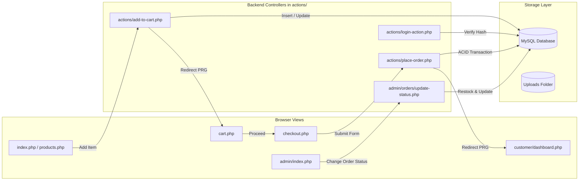

# EasyShop — Architecture & Folder Structure

In this section, you will learn how the EasyShop project is organized on disk, the exact responsibility of every directory and file, their interdependencies, and what happens if a specific file is missing.

---

## 1. Complete Project Folder Tree

Here is the actual directory and file tree of EasyShop:

```text
easyshop/
│
├── actions/                          # Backend Action Controllers (Handle POST requests)
│   ├── add-to-cart.php               # Adds product to customer's active database cart
│   ├── add-to-wishlist.php           # Adds product to customer's wishlist
│   ├── cancel-order.php              # Customer-initiated cancellation (if permitted)
│   ├── category-add-action.php       # Admin: Creates new category
│   ├── category-delete-action.php    # Admin: Deletes category
│   ├── category-edit-action.php      # Admin: Updates category details
│   ├── change-password.php           # Customer: Updates password with hash verification
│   ├── login-action.php              # Authenticates user credentials & sets session
│   ├── logout-action.php             # Destroys session and logs user out
│   ├── place-order.php               # Places order (ACID transaction, row lock, stock deduct)
│   ├── product-add-action.php        # Admin: Inserts product with photo upload
│   ├── product-delete-action.php     # Admin: Deletes or soft-deactivates product
│   ├── product-edit-action.php       # Admin: Modifies product details and image
│   ├── register-action.php           # Validates new user & inserts into database
│   ├── remove-from-cart.php          # Deletes specific item from customer's cart
│   ├── remove-from-wishlist.php      # Removes product from user's wishlist
│   ├── update-cart.php               # Adjusts item quantity in shopping cart
│   └── update-profile.php            # Updates customer name, phone, shipping address
│
├── admin/                            # Administrator Management Portal (Role Guarded)
│   ├── categories/                   # Category Management Views
│   │   ├── add.php                   # Form to add a new category
│   │   ├── edit.php                  # Form to edit an existing category
│   │   └── index.php                 # List of all categories with action buttons
│   ├── customers/                    # Customer Directory Views
│   │   ├── details.php               # Customer profile, total spend & order list
│   │   ├── index.php                 # Paginated customer directory with search
│   │   └── toggle-status.php         # Admin action: Toggle active/inactive status
│   ├── orders/                       # Order Processing Views
│   │   ├── details.php               # Order details, printable receipt & status form
│   │   ├── index.php                 # Filterable order list (status tabs & search)
│   │   └── update-status.php         # Action: Advances order status & stock restock
│   ├── products/                     # Product Management Views
│   │   ├── add.php                   # Form to add product with file upload
│   │   ├── edit.php                  # Form to edit product and replace photo
│   │   ├── index.php                 # Catalog directory with search, filter & pagination
│   │   └── view.php                  # Quick view modal/detail preview
│   └── index.php                     # Administrative Analytics Dashboard
│
├── assets/                           # Static Assets (Frontend)
│   ├── css/
│   │   └── style.css                 # Custom CSS rules, color palette, badges, spacing
│   ├── js/
│   │   └── main.js                   # Vanilla JS: Modals, validation, toast notifications
│   └── images/                       # UI SVG icons, category graphics, sample photos
│
├── auth/                             # Authentication Views (Frontend Forms)
│   ├── login.php                     # Customer & Admin login form
│   ├── logout.php                    # Simple redirect script to logout-action.php
│   └── register.php                  # New customer registration form
│
├── config/                           # Application & Database Configuration
│   ├── config.example.php            # Configuration template for developers
│   └── database.php                  # Active DB connection & environment handler
│
├── customer/                         # Customer Self-Service Portal (Login Guarded)
│   ├── dashboard.php                 # Metrics (orders, pending, wishlist) & recent orders
│   ├── order-details.php             # Customer single order receipt (IDOR protected)
│   ├── orders.php                    # Customer complete order history
│   ├── profile.php                   # Profile update & password change forms
│   └── wishlist.php                  # Customer wishlist items with "Move to Cart"
│
├── database/                         # Database Migration & Schema Files
│   ├── easyshop.sql                  # Initial development schema
│   ├── easyshop_production.sql       # Clean production schema with admin seed
│   └── sample-data.sql               # Demonstration categories and products
│
├── includes/                         # Reusable Shared Partials & Core Libraries
│   ├── admin-check.php               # Guard: requires admin authentication
│   ├── admin-footer.php              # Admin HTML closing tags and scripts
│   ├── admin-header.php              # Admin HTML head, navbar and layout wrapper
│   ├── admin-sidebar.php             # Admin left sidebar navigation menu
│   ├── auth-check.php                # Guard: requires customer authentication
│   ├── csrf.php                      # CSRF token generator & timing-safe validator
│   ├── footer.php                    # Customer storefront footer & scripts
│   ├── functions.php                 # Central helper library (auth, session, cart, upload)
│   ├── header.php                    # Customer HTML head, meta tags, CSS imports
│   └── navbar.php                    # Storefront top navigation, search bar & counters
│
├── tests/                            # Automated Regression & Security Test Suites
│   ├── test-phase2.php               # Phase 2: Auth and user validation tests
│   ├── test-phase3.php               # Phase 3: Category & product management tests
│   ├── test-phase4.php               # Phase 4: Dynamic storefront & catalog tests
│   ├── test-phase5.php               # Phase 5: Cart & wishlist database tests
│   ├── test-phase5b.php              # Phase 5b: Extended cart integration tests
│   ├── test-phase6.php               # Phase 6: Checkout, order placement & ACID tests
│   ├── test-phase7.php               # Phase 7: Account & admin dashboard tests
│   └── test-phase8.php               # Phase 8: Full security & E2E system tests
│
├── uploads/                          # User-Uploaded Files
│   ├── .htaccess                     # Hardening: blocks script execution in uploads
│   └── products/                     # Product catalog images uploaded by admin
│
├── .gitignore                        # Git exclusion rules (credentials, cache, logs)
├── .htaccess                         # Root Apache security configuration
├── cart.php                          # Customer shopping cart page
├── checkout.php                      # Order checkout page (Cash on Delivery)
├── database-test.php                 # Database connectivity diagnostic utility
├── index.php                         # Storefront Homepage
├── order-confirmation.php            # Post-order confirmation & printable receipt
├── product-details.php               # Single product view with reviews & add-to-cart
├── products.php                      # Searchable, filterable product catalog
├── README.md                         # Project documentation
├── DEPLOYMENT.md                     # InfinityFree deployment guide
├── SECURITY.md                       # Security architecture & hardening report
└── TEST-REPORT.md                    # Verification test report matrix
```

---

## 2. Directory-by-Directory Breakdown

### 📂 `includes/` — The Core Reusable Foundation
This is the most critical folder in EasyShop. Almost every page in the application includes one or more files from this directory.

| File | Type | Purpose & Responsibility | Dependencies | What Happens if Removed? |
|---|---|---|---|---|
| **`functions.php`** | Backend Logic | The heart of EasyShop. Manages `init_session()`, role guards (`isLoggedIn()`, `isAdmin()`), `e()` (XSS output escaper), PKR formatting, `get_user_cart()`, `get_shipping_fee()`, and `secure_upload_image()`. | None (self-contained) | **Fatal System Crash**. Every page including header, cart, and actions will fail immediately with fatal errors. |
| **`csrf.php`** | Backend Security | Generates session CSRF tokens (`get_csrf_token()`), renders hidden input (`csrf_field()`), and validates token submissions with timing-safe `hash_equals()`. | `functions.php` | **Security Failure**. All POST forms will either fail CSRF validation or become vulnerable to cross-site request forgery attacks. |
| **`header.php`** | Frontend Partial | Contains the `<!DOCTYPE html>`, `<head>`, meta viewport tags, Bootstrap 5 CSS, Bootstrap Icons, and `assets/css/style.css`. | `functions.php` | The storefront UI will have no styling, fonts, or responsive viewport. |
| **`navbar.php`** | Frontend Partial | Storefront top navigation bar. Displays logo, category links, search bar, dynamic cart counter (`get_cart_count()`), wishlist counter, and login/account dropdown. | `functions.php` | Navigation will disappear. Users won't be able to search, view their cart count, or access their account. |
| **`footer.php`** | Frontend Partial | Closing footer with customer service links, payment badges, copyright, and Bootstrap 5 JS bundle script tags. | None | Footer disappears and JavaScript components (modals, dropdowns) stop working. |
| **`admin-header.php`** | Frontend / Auth | Top bar for the administrative portal. Contains admin page title, notifications, profile dropdown, and calls `requireAdmin()`. | `functions.php`, `config/database.php` | Admin layout breaks, and admin routes lose visual structure and guards. |
| **`admin-sidebar.php`** | Frontend Partial | Left-hand navigation sidebar for admin portal with links to Dashboard, Products, Categories, Orders, and Customers. | `functions.php` | Admin navigation disappears; admin cannot switch between modules. |
| **`admin-check.php`** | Backend Guard | Shortcut guard script that calls `requireAdmin()`. | `functions.php` | Direct access to admin action scripts without authentication becomes possible. |
| **`auth-check.php`** | Backend Guard | Shortcut guard script that calls `requireLogin()`. | `functions.php` | Customer-only action scripts become accessible to unauthenticated guests. |

---

### 📂 `config/` — Configuration & Environment Handling

| File | Type | Purpose & Responsibility | Dependencies | What Happens if Removed? |
|---|---|---|---|---|
| **`database.php`** | Config / DB | Creates the global MySQLi database connection variable `$conn`. Detects if `config/database.local.php` exists; if so, loads local credentials; otherwise falls back to defaults. Sets character set to `utf8mb4`. Enforces error suppression (`display_errors = 0`) when `APP_ENV === 'production'`. | `database.local.php` (optional) | **Database Connection Fails**. Every catalog, login, cart, and order query will fail immediately. |
| **`config.example.php`** | Documentation | An example configuration file showing how to define `DB_HOST`, `DB_NAME`, `DB_USER`, `DB_PASS`, and `APP_ENV`. | None | No impact on code execution; acts as a template for developers. |

---

### 📂 `actions/` — Backend Processing Controllers (POST Handlers)
Files in this directory do **not** render full HTML views. Instead, they process data sent by forms via POST, interact with MySQL, set flash notification messages (`setFlash()`), and redirect the user using the **Post/Redirect/Get (PRG)** pattern.

| File | Triggered By | Operations Performed | Redirects To |
|---|---|---|---|
| **`register-action.php`** | `auth/register.php` form | Validates name, unique email, phone, and password; hashes password with `password_hash()`; inserts row into `users`. | `auth/login.php` on success; back to `register.php` on error. |
| **`login-action.php`** | `auth/login.php` form | Queries user by email; checks `status === 'active'`; verifies password with `password_verify()`; calls `session_regenerate_id(true)`; populates `$_SESSION['user']`. | `admin/index.php` (admin) or `customer/dashboard.php` (customer). |
| **`logout-action.php`** | Navbar / Dropdown logout | Unsets `$_SESSION['user']`, destroys session, and removes session cookie. | `auth/login.php` with success notification. |
| **`add-to-cart.php`** | Product card / Details page | Validates stock availability; inserts or updates row in `cart_items` for logged-in user. | Referrer page or `cart.php`. |
| **`update-cart.php`** | `cart.php` quantity controls | Updates `quantity` in `cart_items` table after ensuring it does not exceed `products.stock`. | `cart.php`. |
| **`remove-from-cart.php`** | `cart.php` delete button | Deletes specific row from `cart_items` matching `cart_item_id` and `user_id`. | `cart.php`. |
| **`place-order.php`** | `checkout.php` form | **Most critical action script**: Initiates ACID transaction, locks stock rows with `FOR UPDATE`, recalculates order total server-side, generates order number, inserts `orders` & `order_items`, decrements stock, and empties cart. | `order-confirmation.php?order=...` on success; `checkout.php` on failure. |
| **`change-password.php`** | `customer/profile.php` form | Verifies current password with `password_verify()`, hashes new password, and updates `users.password`. | `customer/profile.php`. |
| **`update-profile.php`** | `customer/profile.php` form | Validates unique email, name, phone, address; updates `users` table. | `customer/profile.php`. |

---

### 📂 Root Storefront Files (Public Views)

| File | URL Path | Responsibilities |
|---|---|---|
| **`index.php`** | `/` | Homepage of EasyShop. Displays promotional hero banner, featured category cards, top featured products, and value proposition cards (free shipping over limit, 24/7 support, COD). |
| **`products.php`** | `/products.php` | The main shop catalog. Features category sidebar filters, search bar, price range filter, stock availability filter, sorting dropdown (price low/high, newest), and pagination. |
| **`product-details.php`** | `/product-details.php?id=X` | Single product showcase. Displays high-resolution image, SKU, stock status badge, customer reviews, rating stars, related products, and "Add to Cart" / "Add to Wishlist" buttons. |
| **`cart.php`** | `/cart.php` | Customer shopping cart. Itemizes products, prices, quantity selectors, line subtotals, flat **Rs. 200** shipping fee calculation, grand total, and direct checkout link. |
| **`checkout.php`** | `/checkout.php` | Final checkout gateway. Enforces customer login and non-empty cart guards. Collects recipient name, Pakistani mobile number, street delivery address, and enforces Cash on Delivery (COD). |
| **`order-confirmation.php`** | `/order-confirmation.php?order=...` | Thank-you page and printable customer receipt. Features tenant check (`WHERE order_number = ? AND user_id = ?`) to prevent unauthorized receipt viewing. |

---

### 📂 `customer/` — Customer Portal

| File | Guard | Key Features |
|---|---|---|
| **`dashboard.php`** | `requireLogin()` | Customer overview: 4 metric summary cards (Total Orders, Pending Orders, Delivered Orders, Wishlist Count) and a table of the 5 most recent orders. |
| **`orders.php`** | `requireLogin()` | Complete paginated order history with order numbers, dates, payment status, order status badges, total amount, and links to detailed receipts. |
| **`order-details.php`** | `requireLogin()` | Full itemized invoice of a specific customer order, showing snapshots of item names, prices at purchase time, delivery address, and print button. |
| **`profile.php`** | `requireLogin()` | Tabbed account settings: Edit personal profile (name, phone, delivery address) and Change Password. |
| **`wishlist.php`** | `requireLogin()` | Displays saved items with live price, stock status, "Move to Cart" button, and "Remove" button. |

---

### 📂 `admin/` — Store Administration

| Directory / File | Guard | Key Features |
|---|---|---|
| **`index.php`** | `requireAdmin()` | Administrative analytics: Total products, active count, low stock alert, total categories, registered customers, total orders, pending orders, and **realized sales revenue** (from delivered orders). |
| **`products/index.php`** | `requireAdmin()` | Admin product catalog table with photo thumbnails, SKU, category, price, stock badges, and edit/delete controls. |
| **`products/add.php`** | `requireAdmin()` | Form to insert new product with category selection, price, stock, description, and secure image upload. |
| **`products/edit.php`** | `requireAdmin()` | Form to modify product details, change status (`active`/`inactive`), and optionally upload a replacement photo. |
| **`categories/index.php`** | `requireAdmin()` | List of all categories with product counts, status badges, and management options. |
| **`orders/index.php`** | `requireAdmin()` | Master order log with status filters (`pending`, `confirmed`, `processing`, `shipped`, `delivered`, `cancelled`) and search. |
| **`orders/details.php`** | `requireAdmin()` | Detailed order review with customer shipping information, itemized table, and **order status update form**. |
| **`orders/update-status.php`** | `requireAdmin()` | Action script: Transitions order status; if status is changed to `cancelled`, atomically restores inventory to catalog **strictly once**. |
| **`customers/index.php`** | `requireAdmin()` | Paginated customer directory with search, order counts, and lifetime spending aggregates. |
| **`customers/toggle-status.php`** | `requireAdmin()` | Toggles customer account between `active` and `inactive`, with safeguards preventing admin self-deactivation. |

---

## 3. Component Interaction Flowchart

This flowchart illustrates how frontend pages, backend actions, and the database collaborate:



---

## 4. Key Takeaways for Viva

1. **Why is the `actions/` folder separate from view files?**  
   To follow the **Separation of Concerns** principle. View files (`.php` files in root, `customer/`, and `admin/`) generate HTML for the user. Action files handle data processing, validation, and database updates, then redirect using the Post/Redirect/Get pattern so users cannot accidentally resubmit forms by refreshing their browser.
2. **What role does `includes/functions.php` play?**  
   It is the central helper library of the application. It ensures session parameters are hardened, provides user authentication and role checking, formats currency in Pakistani Rupees, manages flash notifications, and escapes output against XSS.

---

Proceed to **[`03-Database-Design.md`](file:///e:/intenship/easyshop/documentation/learning-guide/03-Database-Design.md)** to master the database schema, table structures, and foreign key relationships.
