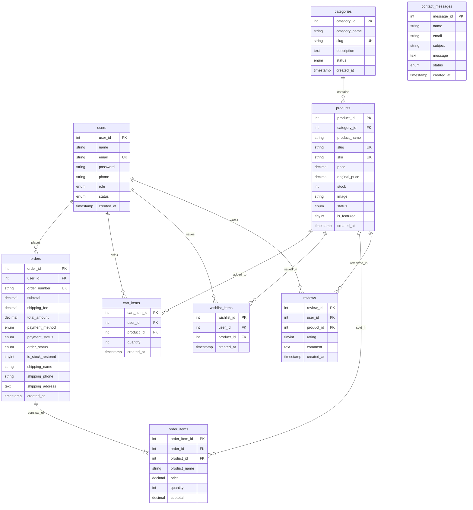

# EasyShop — Database Design from A to Z

In this document, you will explore the entire database architecture of EasyShop. You will learn every table, column, data type, foreign key relationship, and constraint, as well as why storing price snapshots in order items and using ACID database transactions is essential in e-commerce.

---

## 1. Database Fundamentals with EasyShop Examples

Before examining the tables, let us understand fundamental database concepts using real examples from EasyShop:

| Concept | Simple Definition | EasyShop Real Example |
|---|---|---|
| **Database** | A structured container holding organized tables of data. | `easyshop_db` contains all 9 tables of our store. |
| **Table** | A specific collection of related records arranged in rows and columns. | The `products` table stores information about items for sale. |
| **Row (Record)** | A single individual entry inside a table. | One row in `products` represents the *"Wireless Earbuds Pro"*. |
| **Column (Field)** | A specific attribute or property shared by every row in a table. | `price`, `stock`, and `sku` are columns in the `products` table. |
| **Primary Key (PK)** | A unique identifier guaranteeing every row in a table can be uniquely referenced. Cannot be NULL. | `user_id` in `users`, `product_id` in `products`, `order_id` in `orders`. |
| **Foreign Key (FK)** | A column in one table that links directly to the Primary Key of another table, enforcing referential integrity. | `category_id` in `products` references `category_id` in `categories`. |
| **AUTO_INCREMENT** | Automatically generates a sequential integer (1, 2, 3...) when a new row is inserted. | When a new customer registers, MySQL assigns the next `user_id`. |
| **UNIQUE** | A constraint guaranteeing that no two rows can have the same value in this column. | `email` in `users` (prevents multiple accounts with the same email). |
| **NOT NULL** | Enforces that a column must contain a valid value and cannot be left blank/empty. | `product_name` and `price` must never be NULL. |
| **DEFAULT** | A fallback value automatically assigned if no value is explicitly provided during INSERT. | `order_status` defaults to `'pending'`; `shipping_fee` defaults to `200.00`. |
| **ENUM** | A string object with a value chosen from an explicit list of permitted values. | `role ENUM('customer', 'admin')`; `order_status ENUM('pending', 'confirmed', 'processing', 'shipped', 'delivered', 'cancelled')`. |
| **VARCHAR(n)** | Variable-length character string up to `n` characters. Efficient for short text. | `name VARCHAR(100)`, `email VARCHAR(191)`. |
| **DECIMAL(m, d)** | Exact numerical data type with `m` total digits and `d` decimal digits. **Essential for currency** (never use FLOAT or DOUBLE for money because of floating-point rounding errors). | `price DECIMAL(10, 2)` can store values up to Rs. 99,999,999.99 with exact paisas. |
| **TEXT** | Storage for large unstructured strings. | `description` in products, `shipping_address` in orders. |
| **TIMESTAMP** | Automatically records date and time in `YYYY-MM-DD HH:MM:SS` format. | `created_at TIMESTAMP DEFAULT CURRENT_TIMESTAMP` logs the exact moment an order was created. |
| **InnoDB** | The default MySQL storage engine that supports ACID transactions, foreign keys, and row-level locking. | Used across all 9 EasyShop tables. |
| **utf8mb4** | The standard UTF-8 character encoding supporting all languages, Urdu characters, and emojis. | Character set across all tables with collation `utf8mb4_unicode_ci`. |
| **Index (KEY)** | A performance data structure (B-tree) allowing the database to look up matching rows in milliseconds instead of scanning the entire table. | `KEY idx_orders_user_id (user_id)` accelerates looking up all orders for a customer. |

---

## 2. Foreign Key Actions: CASCADE vs RESTRICT vs SET NULL

When a parent record is deleted or updated, what happens to child records? EasyShop uses three distinct policies:

1. **`ON DELETE CASCADE`**:  
   If the parent row is deleted, MySQL automatically deletes all matching child rows.  
   *EasyShop Example*: In `cart_items`, if a user is deleted from `users`, their cart items are automatically wiped out (`ON DELETE CASCADE`).
2. **`ON DELETE RESTRICT`**:  
   MySQL **forbids** deleting the parent row if any child rows reference it.  
   *EasyShop Example*: In `products`, you cannot delete a category if products are still assigned to it (`ON DELETE RESTRICT`). This prevents orphaned products.
3. **`ON DELETE SET NULL`**:  
   If the parent row is deleted, the foreign key column in the child table is set to `NULL` while preserving the child row.  
   *EasyShop Example*: In `order_items`, if an old product is eventually purged from the catalog, the historical line item in `order_items` is kept for accounting, but `product_id` becomes `NULL` (`ON DELETE SET NULL`).

---

## 3. Entity-Relationship (ER) Diagram

Here is the complete entity-relationship model of EasyShop:



---

## 4. Deep Inspection of Every Database Table

### Table 1: `users`
- **Purpose**: Stores all authenticated identities (customers and administrators).
- **Columns**:
  - `user_id` (`INT UNSIGNED`, PK, AUTO_INCREMENT): Unique user identifier.
  - `name` (`VARCHAR(100)`, NOT NULL): Full name of the user.
  - `email` (`VARCHAR(191)`, NOT NULL, UNIQUE `uq_users_email`): Login email address. (191 characters fits MySQL InnoDB UTF-8 767-byte prefix limits).
  - `password` (`VARCHAR(255)`, NOT NULL): Bcrypt cryptographic password hash (produced by `password_hash()`).
  - `phone` (`VARCHAR(20)`, DEFAULT NULL): Pakistani contact number.
  - `role` (`ENUM('customer', 'admin')`, NOT NULL, DEFAULT `'customer'`): Defines system permissions.
  - `status` (`ENUM('active', 'inactive')`, NOT NULL, DEFAULT `'active'`): Allows administrators to deactivate compromised accounts.
  - `created_at` (`TIMESTAMP`, DEFAULT CURRENT_TIMESTAMP): Registration timestamp.
- **Why Required**: Centralizes identity and authorization.

---

### Table 2: `categories`
- **Purpose**: Defines store departments (e.g., Electronics, Fashion, Home & Living).
- **Columns**:
  - `category_id` (`INT UNSIGNED`, PK, AUTO_INCREMENT): Unique category ID.
  - `category_name` (`VARCHAR(100)`, NOT NULL): Display name.
  - `slug` (`VARCHAR(100)`, NOT NULL, UNIQUE `uq_categories_slug`): URL-friendly name (e.g. `electronics`).
  - `description` (`TEXT`, DEFAULT NULL): Category summary.
  - `status` (`ENUM('active', 'inactive')`, NOT NULL, DEFAULT `'active'`): Visibility toggle.
  - `created_at` (`TIMESTAMP`, DEFAULT CURRENT_TIMESTAMP).
- **Why Required**: Organizes catalog items for navigation and search filtering.

---

### Table 3: `products`
- **Purpose**: Master product catalog containing SKUs, prices, inventory counts, and image references.
- **Columns**:
  - `product_id` (`INT UNSIGNED`, PK, AUTO_INCREMENT): Unique product identifier.
  - `category_id` (`INT UNSIGNED`, NOT NULL, FK): References `categories(category_id)`.
  - `product_name` (`VARCHAR(200)`, NOT NULL): Commercial title.
  - `slug` (`VARCHAR(200)`, NOT NULL, UNIQUE): URL-friendly string.
  - `sku` (`VARCHAR(50)`, NOT NULL, UNIQUE): Stock Keeping Unit (e.g., `ELEC-WEP-001`).
  - `description` (`TEXT`, DEFAULT NULL): Full specification.
  - `price` (`DECIMAL(10, 2)`, NOT NULL): Current selling price in PKR.
  - `original_price` (`DECIMAL(10, 2)`, DEFAULT NULL): Optional strike-through price for discounts.
  - `stock` (`INT UNSIGNED`, NOT NULL, DEFAULT 0): Available warehouse inventory.
  - `image` (`VARCHAR(255)`, NOT NULL): Relative path to product photo.
  - `status` (`ENUM('active', 'inactive')`, NOT NULL, DEFAULT `'active'`).
  - `is_featured` (`TINYINT(1) UNSIGNED`, NOT NULL, DEFAULT 0): Flag for homepage showcase.
  - `created_at` (`TIMESTAMP`, DEFAULT CURRENT_TIMESTAMP).
- **Why Required**: Core inventory entity.

---

### Table 4: `cart_items`
- **Purpose**: Database-backed shopping cart per customer.
- **Columns**:
  - `cart_item_id` (`INT UNSIGNED`, PK, AUTO_INCREMENT).
  - `user_id` (`INT UNSIGNED`, NOT NULL, FK): References `users(user_id)`.
  - `product_id` (`INT UNSIGNED`, NOT NULL, FK): References `products(product_id)`.
  - `quantity` (`INT UNSIGNED`, NOT NULL, DEFAULT 1).
  - `created_at` (`TIMESTAMP`, DEFAULT CURRENT_TIMESTAMP).
- **Key Constraints**:
  - `UNIQUE KEY uq_cart_user_product (user_id, product_id)`: A customer cannot have two separate rows for the same product. Instead, quantity is incremented.
  - `ON DELETE CASCADE`: If user or product is deleted, cart entry is removed.

---

### Table 5: `wishlist_items`
- **Purpose**: Stores customer saved/favorite items.
- **Columns**:
  - `wishlist_id` (`INT UNSIGNED`, PK, AUTO_INCREMENT).
  - `user_id` (`INT UNSIGNED`, NOT NULL, FK).
  - `product_id` (`INT UNSIGNED`, NOT NULL, FK).
  - `created_at` (`TIMESTAMP`, DEFAULT CURRENT_TIMESTAMP).
- **Key Constraints**:
  - `UNIQUE KEY uq_wishlist_user_product (user_id, product_id)`: Prevents duplicate bookmarks.

---

### Table 6: `orders`
- **Purpose**: Master order header tracking financial totals, shipping info, and status.
- **Columns**:
  - `order_id` (`INT UNSIGNED`, PK, AUTO_INCREMENT).
  - `user_id` (`INT UNSIGNED`, DEFAULT NULL, FK): References `users(user_id)` with `ON DELETE SET NULL`.
  - `order_number` (`VARCHAR(50)`, NOT NULL, UNIQUE): Human-readable reference (e.g. `ORD-20261106-A39DF1`).
  - `subtotal` (`DECIMAL(10, 2)`, NOT NULL): Sum of item prices.
  - `shipping_fee` (`DECIMAL(10, 2)`, NOT NULL, DEFAULT 200.00): Flat delivery charge.
  - `total_amount` (`DECIMAL(10, 2)`, NOT NULL): `subtotal + shipping_fee`.
  - `payment_method` (`ENUM('cod')`, NOT NULL, DEFAULT `'cod'`).
  - `payment_status` (`ENUM('pending', 'paid', 'failed')`, NOT NULL, DEFAULT `'pending'`).
  - `order_status` (`ENUM('pending', 'confirmed', 'processing', 'shipped', 'delivered', 'cancelled')`, NOT NULL, DEFAULT `'pending'`).
  - `is_stock_restored` (`TINYINT(1) UNSIGNED`, NOT NULL, DEFAULT 0): **Atomic safety flag**. Ensures stock is only restored once when an order is cancelled.
  - `shipping_name` (`VARCHAR(100)`, NOT NULL).
  - `shipping_phone` (`VARCHAR(20)`, NOT NULL).
  - `shipping_address` (`TEXT`, NOT NULL).
  - `created_at` (`TIMESTAMP`, DEFAULT CURRENT_TIMESTAMP).

---

### Table 7: `order_items` (Historical Line-Item Snapshot)
- **Purpose**: Records individual products sold within an order.
- **Columns**:
  - `order_item_id` (`INT UNSIGNED`, PK, AUTO_INCREMENT).
  - `order_id` (`INT UNSIGNED`, NOT NULL, FK): References `orders(order_id)` with `ON DELETE CASCADE`.
  - `product_id` (`INT UNSIGNED`, DEFAULT NULL, FK): References `products(product_id)` with `ON DELETE SET NULL`.
  - `product_name` (`VARCHAR(200)`, NOT NULL): **Snapshot of product title at time of order**.
  - `price` (`DECIMAL(10, 2)`, NOT NULL): **Snapshot of unit price at time of order**.
  - `quantity` (`INT UNSIGNED`, NOT NULL, DEFAULT 1).
  - `subtotal` (`DECIMAL(10, 2)`, NOT NULL): `price * quantity`.

> [!IMPORTANT]
> **Viva Question**: *"Why does `order_items` duplicate `product_name` and `price` instead of just referencing `products.product_id`?"*  
> **Answer**: This is called **Historical Data Preservation**. In e-commerce, product names and prices change over time (e.g. inflation, promotions). If a customer bought an item for Rs. 2,499 today and the store raises the price to Rs. 3,500 tomorrow, looking up the historical invoice must show Rs. 2,499. If you only referenced `products.price`, previous invoices would erroneously change!

---

### Table 8: `reviews`
- **Purpose**: Stores customer ratings and written feedback for products.
- **Columns**:
  - `review_id` (`INT UNSIGNED`, PK, AUTO_INCREMENT).
  - `user_id` (`INT UNSIGNED`, NOT NULL, FK): Author of the review.
  - `product_id` (`INT UNSIGNED`, NOT NULL, FK): Product being evaluated.
  - `rating` (`TINYINT UNSIGNED`, NOT NULL): Integer 1 to 5 stars.
  - `comment` (`TEXT`, DEFAULT NULL): Written review.
  - `created_at` (`TIMESTAMP`, DEFAULT CURRENT_TIMESTAMP).

---

### Table 9: `contact_messages`
- **Purpose**: Captures inquiries submitted through the contact form.
- **Columns**:
  - `message_id` (`INT UNSIGNED`, PK, AUTO_INCREMENT).
  - `name` (`VARCHAR(100)`, NOT NULL).
  - `email` (`VARCHAR(191)`, NOT NULL).
  - `subject` (`VARCHAR(150)`, NOT NULL).
  - `message` (`TEXT`, NOT NULL).
  - `status` (`ENUM('unread', 'read', 'replied')`, NOT NULL, DEFAULT `'unread'`).
  - `created_at` (`TIMESTAMP`, DEFAULT CURRENT_TIMESTAMP).

---

## 5. ACID Database Transactions in EasyShop

During checkout (`actions/place-order.php`), EasyShop executes 5 distinct SQL operations:
1. Lock product rows (`SELECT ... FOR UPDATE`).
2. Insert order header into `orders`.
3. Insert items into `order_items`.
4. Deduct inventory in `products`.
5. Empty customer's cart in `cart_items`.

If the server loses power or a query fails at Step 4, what happens? Without transactions, the order would exist but stock wouldn't deduct, corrupting the inventory.

MySQL **ACID Transactions** prevent this:
- **A — Atomicity**: All 5 operations succeed together, or all fail together (*all or nothing*).
- **C — Consistency**: Database rules, types, and foreign keys remain valid throughout.
- **I — Isolation**: Uncommitted changes are invisible to other concurrent users.
- **D — Durability**: Once `mysqli_commit($conn)` is called, data is permanently written to disk.

```php
mysqli_begin_transaction($conn);
try {
    // 1. Lock rows, 2. Insert order, 3. Insert items, 4. Deduct stock, 5. Clear cart
    mysqli_commit($conn); // Saved permanently
} catch (Throwable $e) {
    mysqli_rollback($conn); // Everything is undone automatically!
}
```

---

Proceed to **[`04-PHP-and-Backend-Code.md`](file:///e:/intenship/easyshop/documentation/learning-guide/04-PHP-and-Backend-Code.md)** to inspect the core PHP functions and backend code patterns.
