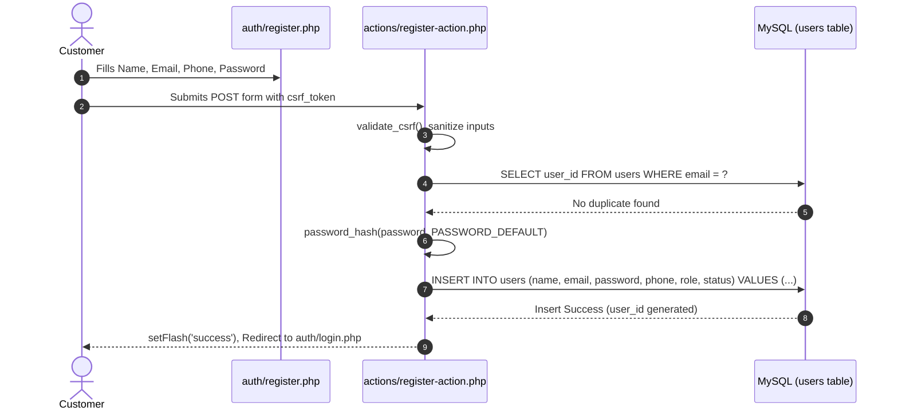
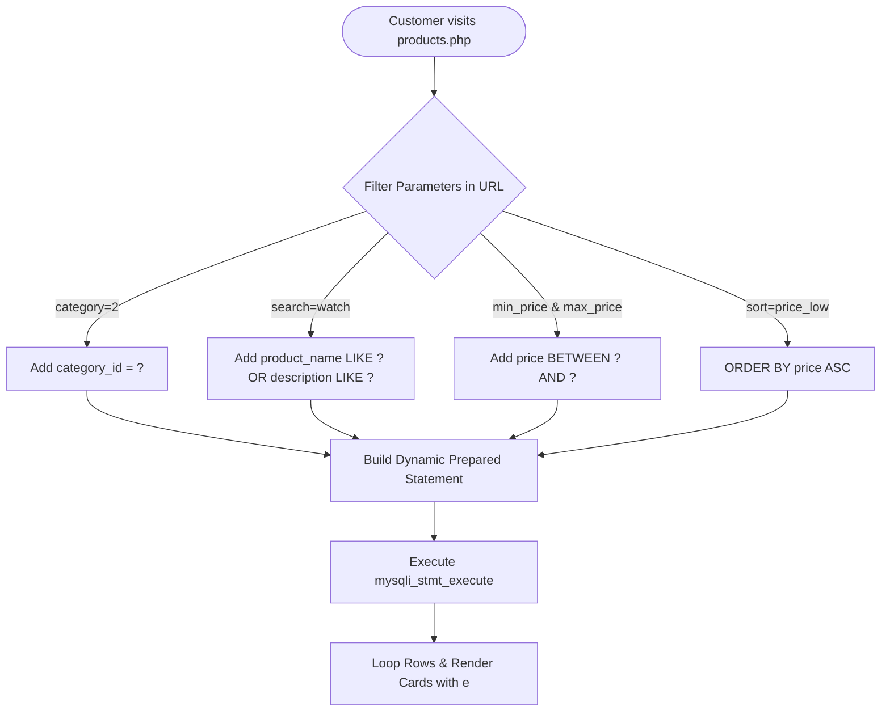
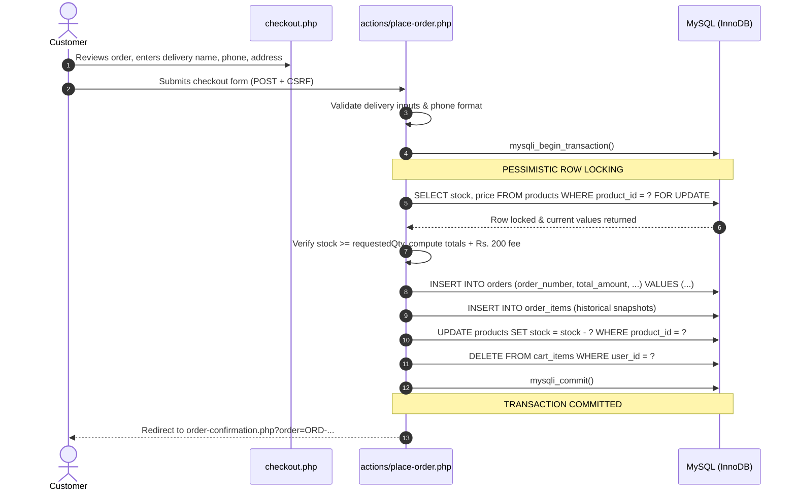
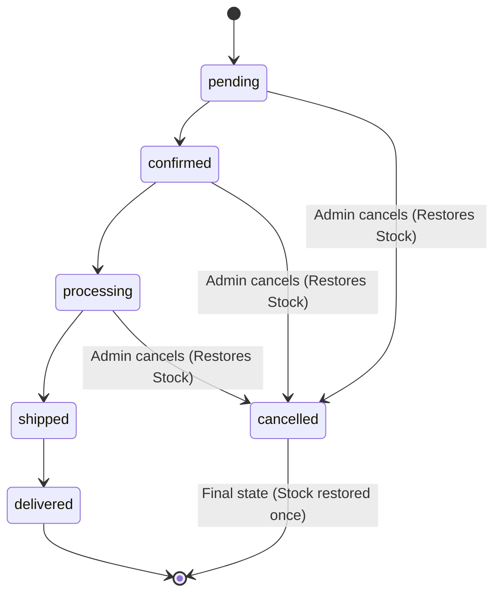

# EasyShop — Feature-by-Feature Internal Workflows

In this document, you will walk through every major feature of EasyShop from the user's initial click to the backend controller, database execution, and final response.

---

## Feature A: Registration & Authentication



### Detailed Breakdown:
1. **User Action**: The visitor opens `auth/register.php`, inputs name, email, phone, and password, then clicks **"Create Account"**.
2. **Receiving Controller**: `actions/register-action.php`.
3. **Validations**:
   - CSRF validation: `validate_csrf()`.
   - Name length: 3 to 100 characters.
   - Email format: `filter_var($email, FILTER_VALIDATE_EMAIL)`.
   - Phone format: Between 10 and 15 digits (`preg_replace('/[^0-9]/', '', $phone)`).
   - Password strength: Minimum 6 characters.
   - **Uniqueness Check**: `SELECT user_id FROM users WHERE email = ? LIMIT 1`. If duplicate exists, aborts with error flash.
4. **Password Hashing**: `password_hash($password, PASSWORD_DEFAULT)` produces a 60-character Bcrypt hash.
5. **Database Operation**: `INSERT INTO users (name, email, password, phone, role, status) VALUES (?, ?, ?, ?, 'customer', 'active')`.
6. **Response**: Redirects to `auth/login.php` with a success alert: *"Account created successfully! Please log in."*

---

## Feature B: User Login & Session Creation

1. **User Action**: User enters email and password on `auth/login.php` and clicks **"Sign In"**.
2. **Receiving Controller**: `actions/login-action.php`.
3. **Execution & Logic**:
   - Query: `SELECT user_id, name, email, password, phone, role, status FROM users WHERE email = ? LIMIT 1`.
   - **Password Verification**: `password_verify($password, $user['password'])`.
   - **Account Status Guard**: Checks if `$user['status'] === 'inactive'`. If inactive, blocks login immediately with error flash.
   - **Session Fixation Defense**: `session_regenerate_id(true)`.
   - **Session Storage**: Populates `$_SESSION['user']` with `user_id`, `name`, `email`, `role`, and `status`.
4. **Routing**:
   - If `$user['role'] === 'admin'`, redirects to `admin/index.php`.
   - If `$user['role'] === 'customer'`, redirects to `customer/dashboard.php`.

---

## Feature C: Dynamic Catalog, Search & Filtering



1. **Page**: `products.php`.
2. **Inputs (GET)**: `category`, `search`, `min_price`, `max_price`, `sort`, `page`.
3. **SQL Construction**:
   - Base condition: `WHERE p.status = 'active' AND cat.status = 'active'`.
   - If `category` provided: binds integer parameter.
   - If `search` provided: binds `"%{$search}%"` parameter.
   - If price range provided: binds float parameters.
4. **Pagination**: Uses `LIMIT ? OFFSET ?` calculated from `$page` and `$perPage = 12`.
5. **Output**: Renders responsive Bootstrap grid cards with photo, price in PKR, stock badge, and direct "Add to Cart" button.

---

## Feature D: Shopping Cart Operations

### 1. Adding an Item
- **Trigger**: Customer clicks **"Add to Cart"** button on `product-details.php` or `products.php`.
- **Controller**: `actions/add-to-cart.php` (POST).
- **Authentication**: Requires logged-in customer (`requireLogin()`).
- **Validation**: Checks catalog stock: `SELECT stock, status FROM products WHERE product_id = ?`.
- **Database Query**:
  ```sql
  INSERT INTO cart_items (user_id, product_id, quantity) 
  VALUES (?, ?, ?)
  ON DUPLICATE KEY UPDATE quantity = quantity + VALUES(quantity)
  ```
- **Stock Guard**: If existing cart quantity + new quantity exceeds warehouse stock, clamps to available stock with a warning message.

### 2. Updating Quantity & Removing Items
- **Controller**: `actions/update-cart.php` and `actions/remove-from-cart.php`.
- **Security Check**: Enforces `WHERE user_id = ?` to ensure a customer can only alter their own cart items.

---

## Feature E: Wishlist Management

1. **Adding Item**:
   - **Controller**: `actions/add-to-wishlist.php`.
   - **Query**: `INSERT IGNORE INTO wishlist_items (user_id, product_id) VALUES (?, ?)`.
   - Prevent duplicates via `UNIQUE KEY uq_wishlist_user_product`.
2. **Viewing Wishlist**: `customer/wishlist.php` lists saved products with current price and warehouse availability.
3. **Move to Cart**: Adds item to `cart_items` and deletes from `wishlist_items` in a single click.

---

## Feature F: Checkout & Order Placement (ACID Transaction)

This is the most critical operation in EasyShop.



### Key Technical Safeguards:
1. **Pessimistic Row Locking (`SELECT ... FOR UPDATE`)**:  
   If two customers attempt to buy the last unit of a product at the exact same second, MySQL forces the second request to wait until the first transaction finishes. The second customer then receives an "Insufficient stock" message instead of overselling inventory!
2. **Server-Side Price Calculation**:  
   The prices sent by the browser form are **completely ignored**. PHP queries `products.price` directly from MySQL, calculates line subtotals, adds the centralized Rs. 200 delivery fee (`get_shipping_fee()`), and inserts the verified total.
3. **Historical Snapshots**:  
   `order_items` inserts `product_name` and `price` at checkout time, decoupling the order receipt from future catalog edits.

---

## Feature G: Order Status Workflow & Safe Stock Restoration

In `admin/orders/update-status.php`:



### Stock Restoration Rules:
1. Cancellation is **only permitted** for `pending`, `confirmed`, or `processing` orders.
2. If an order is already `shipped` or `delivered`, cancellation is **rejected** because the physical goods have left the store facility.
3. **Atomic Single-Restoration**:
   - `SELECT is_stock_restored FROM orders WHERE order_id = ? FOR UPDATE`.
   - If `is_stock_restored === 0`:
     - Reads line items from `order_items`.
     - Increments catalog inventory: `UPDATE products SET stock = stock + ? WHERE product_id = ?`.
     - Updates order: `UPDATE orders SET order_status = 'cancelled', is_stock_restored = 1 WHERE order_id = ?`.
   - If the admin accidentally clicks cancel again, `is_stock_restored` is already `1`, so stock is **never incremented twice**.

---

## Feature H: Admin Analytics Dashboard Calculation

In `admin/index.php`, metrics are calculated via optimized aggregate queries:

```sql
SELECT 
    COUNT(*) AS total_orders,
    COALESCE(SUM(CASE WHEN order_status = 'pending' THEN 1 ELSE 0 END), 0) AS pending_orders,
    COALESCE(SUM(CASE WHEN order_status IN ('confirmed', 'processing') THEN 1 ELSE 0 END), 0) AS processing_orders,
    COALESCE(SUM(CASE WHEN order_status = 'delivered' THEN 1 ELSE 0 END), 0) AS delivered_orders,
    COALESCE(SUM(CASE WHEN order_status = 'cancelled' THEN 1 ELSE 0 END), 0) AS cancelled_orders,
    COALESCE(SUM(CASE WHEN order_status = 'delivered' THEN total_amount ELSE 0 END), 0) AS delivered_sales_value
FROM orders;
```

> [!TIP]
> **Viva Question**: *"Does your admin dashboard count cancelled orders as sales?"*  
> **Answer**: No. As shown in the SQL above, `delivered_sales_value` strictly checks `WHERE order_status = 'delivered'`. Pending, processing, and cancelled orders are completely excluded from realized sales revenue.

---

Proceed to **[`06-Security-Explained.md`](file:///e:/intenship/easyshop/documentation/learning-guide/06-Security-Explained.md)** to understand the vulnerabilities and how EasyShop defends against them.
